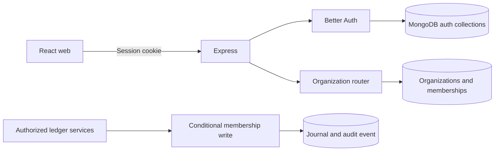

# Aslibooks architecture — Phase 1

## Stack

Organization creation inserts the company and its owner in one transaction.
Listing joins active memberships to organizations. The ledger services use a
separate transaction for the membership fence, journal and audit event.
At the audited baseline these services have no public HTTP entry point.
The mobile, tax, design-token and API-client directories are placeholders.
- Web: React, Vite, TypeScript, MUI
- Mobile: Expo, React Native, TypeScript
- API: Express, TypeScript, Mongoose
- Database: MongoDB Atlas (replica set required for transactions)
- Authentication: Better Auth with MongoDB adapter, subject to integration verification
- AI: OpenAI structured draft generation with explicit human approval
- Workspace: pnpm and Turborepo

## Workspace boundaries
- `apps/web`: responsive web client
- `apps/mobile`: native mobile client
- `apps/api`: API, authentication and persistence
- `packages/accounting`: deterministic double-entry rules
- `packages/tax`: versioned, deterministic GST rules
- `packages/shared`: shared types and validation
- `packages/api-client`: typed API client
- `packages/design-tokens`: shared design primitives

## Financial safety invariants
1. Store money as integer minor units or Decimal128, never binary floats.
2. Every posted journal must balance by currency.
3. Post all related ledger writes in one MongoDB transaction.
4. Posted entries are immutable; correct via reversing entries.
5. Enforce unique idempotency keys and tenant-scoped queries.
6. AI can draft but cannot post transactions or determine tax liabilities.
7. Record immutable audit events for sensitive actions.
8. GST calculations are deterministic, effective-dated and require professional validation before compliance claims.

## Delivery gates
1. Workspace builds and CI passes.
2. Auth and tenant membership enforce authorization in integration tests.
3. Ledger posting/reversal tests pass under concurrency and retries.
4. Invoicing, expenses, payments and GST foundation are validated before launch.
5. Mobile and AI draft flows follow only after core API contracts stabilize.

No live GST filing, IRP e-invoicing or e-way bill integration is claimed in Phase 1.
