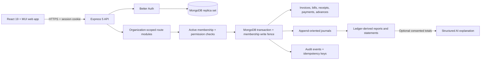

# Aslibooks architecture

## Runtime shape

The workspace is a pnpm/Turborepo monorepo. `apps/api` hosts authentication, health probes and organization-scoped financial routes. `apps/web` is a responsive React/MUI application. `packages/accounting` contains deterministic ledger rules. MongoDB replica-set transactions are required for operations that create or alter financial records.

## Authorization and posting boundary

Better Auth resolves the session identity. Every organization route checks active membership and the role permission. Owner/admin manage organization settings; owner/admin/accountant may post; viewer can read. Ledger writes re-check and update the same membership document inside the financial transaction. That write fence makes a racing suspension or role change conflict with a posting transaction, which must retry and authorize again.

Route modules validate input with strict schemas and apply tenant filters to documents and references. Posting operations write financial documents, journals, audit events and idempotency records atomically. Draft invoices and bills do not post. Issued tax-free sales invoices use accrual accounting (receivables debit, sales income credit). Settlements update the relevant document and control accounts in the same transaction. Corrections use linked credits or authorized reversals; posted journals are protected by Mongoose middleware. This is an application boundary: raw database access and administrators can bypass model hooks.

## Reports and AI boundary

Reports aggregate posted journal lines and source subledgers with INR integer-paise arithmetic and India-local date boundaries. Trial balance checks debit/credit totals; receivable/payable controls are reconciled to open source documents. Contact statements include allocated activity and unallocated advances. CSV output is escaped and cursor-paginated where datasets may grow.

AI is optional. The report explanation workflow requires explicit user consent and sends only selected aggregate report totals and the period. Responses are schema validated and displayed as informational text. The AI integration has no posting or mutation tool. Tax decisions, legal treatment and GST applicability are not delegated to AI.

## Data and operations constraints

- MongoDB transactions require a replica set. The API refuses startup without its authentication/database configuration.
- `/health` is a liveness probe; `/health/ready` is a database-aware readiness probe.
- Runtime database grants have not been verified. Journal middleware does not make storage tamper-proof.
- Email delivery, staging, backup/restore, monitoring and operational recovery have not been rehearsed.
- GST rates and classifications are user entered; tax-bearing invoices remain unposted pending qualified review. No filing certification is claimed.
- There is no native mobile app; mobile support is through the responsive web client.

See [security and recovery](SECURITY.md), [deployment](DEPLOYMENT.md), and the [implementation status](IMPLEMENTATION_STATUS.md) for current gaps.
